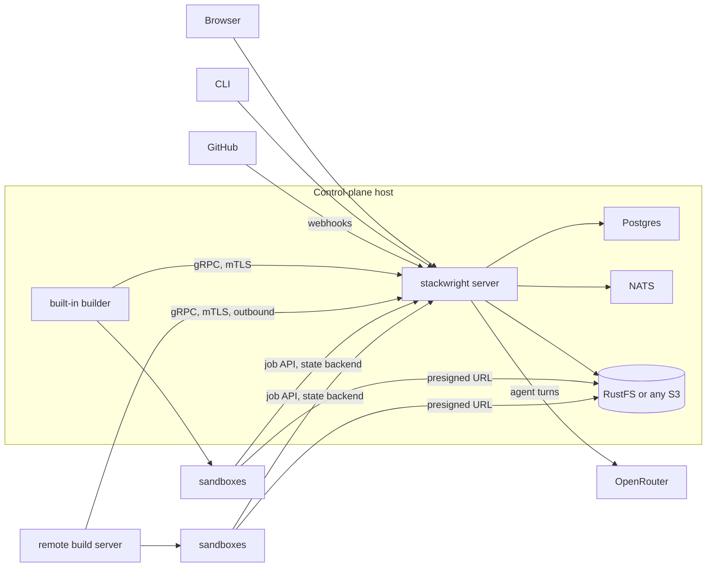
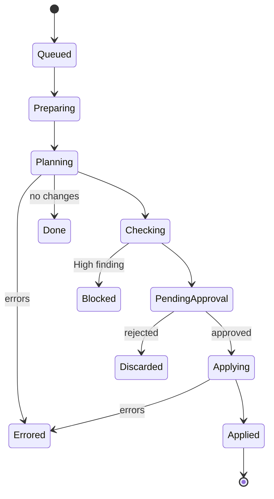

# Stackwright build plan

Stackwright is an open-source, self-hosted workspace for infrastructure code.
An AI agent writes OpenTofu and Terraform. Sandboxes on your own machines run
the plans. Every change shows as a live graph. This file holds the decisions,
the rules for the interface, the phases and the architecture. Build one phase
at a time.

## 1. Decisions

Each decision has a record in [adr/](adr/).

| Decision | Choice | Record |
| --- | --- | --- |
| Licence | Apache-2.0, DCO sign-off | [0001](adr/0001-apache-2-licence.md) |
| Control plane | One Go binary, `stackwright server` | [0002](adr/0002-one-control-plane-binary.md) |
| Jobs and live events | NATS JetStream with a password, reached only by the server | [0003](adr/0003-nats-inside-the-control-plane.md) |
| Key wrapping | A key file from `.env`; Vault Transit optional | [0004](adr/0004-key-file-with-optional-vault.md) |
| Blob storage | Any S3-compatible store, required; RustFS in compose | [0005](adr/0005-s3-required-rustfs-in-compose.md) |
| Agent | Go, inside the server; models through OpenRouter | [0006](adr/0006-agent-in-go-through-openrouter.md) |
| Sandboxes | A backend interface; Docker first; build servers optional | [0007](adr/0007-sandbox-backends-and-build-servers.md) |
| Build server channel | Outbound gRPC stream with mTLS; no WireGuard now | [0008](adr/0008-build-server-channel.md) |
| Sign-in | Local accounts and OIDC; the first admin needs a setup code | [0009](adr/0009-local-accounts-and-oidc.md) |
| Database logins | Migrations as the owner; requests as `stackwright_app`, which row-level security binds | [0012](adr/0012-two-database-logins.md) |
| Accounts | Invite only; providers managed in Settings by instance admins, secrets sealed | [0013](adr/0013-sign-in-providers-and-accounts.md) |
| Orgs | Many per instance; requests name their org | [0014](adr/0014-many-orgs.md) |
| Invites | A one-time link; no email yet | [0015](adr/0015-invite-links.md) |
| Projects | A repository is optional until phase 8; archive, not delete | [0016](adr/0016-projects-before-repositories.md) |
| State access | Personal tokens, checked against the user's role on every request | [0017](adr/0017-personal-tokens-for-state.md) |
| Docker sandboxes | Our own Docker API client, secrets as files, an engine mirror in S3, open egress | [0018](adr/0018-docker-sandboxes.md) |
| Agent sandboxes | A fresh sandbox for each session, with the repo cloned in it; pushes through the server's Git proxy | [0011](adr/0011-agent-session-sandboxes.md) |
| Blobs from sandboxes | Presigned URLs, one per object and method | [0010](adr/0010-sandboxes-reach-s3-by-presigned-url.md) |
| Default engine | OpenTofu; Terraform up to 1.5.7 | — |
| The agent's limit | It edits code and runs speculative plans. It never commits, pushes or opens a PR without a person's approval, and it never applies. | [0011](adr/0011-agent-session-sandboxes.md) |

**Not in this build:**
- Billing, metering and org tiers. Each org keeps a spending cap for the agent.
- BYOC runner pools and org-owned state buckets. Build servers replace pools.
  A self-hosted install already keeps its state.
- A warm pool of sandboxes.

**Later, after phase 22:** the Unikraft sandbox backend, Pulumi, and
Terraform 1.6 and newer.

## 2. Rules for the interface

There is a lot in Stackwright. A user must always know three things: where
they are, what is happening now, and what to do next.

1. **A native desktop shell, no sidebar.** A toolbar with the view switcher,
   "Waiting on you", search and command palette (⌘K), Build servers and
   Settings. Under it, one tab for each open workspace, with a status mark
   when something needs the user. It follows the system's light or dark
   setting.
2. **"Waiting on you".** One inbox for approvals, failed runs, new findings
   and drift. Every item has one button that does the next step.
3. **The workspace opens on Overview.** It shows the state now, the last run,
   and what to do next. Plan graph, Topology, Security, Editor and Run log
   are tabs after it.
4. **The agent lives in the inspector.** The inspector on the right has an
   Agent tab and a Resource tab, and ⌥⌘0 hides it. The Agent tab always says
   which workspace, branch and sandbox it works on.
5. **Every empty state has one primary action.** No projects: "Try the
   sample" or "Import a repository". No model key: the Agent tab says so and
   links to Settings.
6. **A sample project with no cloud.** It uses the `null`, `random` and
   `local` providers. A new user sees a first plan within one minute of
   setup.
7. **Plain status.** A status says what happens next and who must act:
   "Waiting for approval from a reviewer", not only a badge. A run says which
   build server runs it.
8. **Terms explained where they appear.** A short tooltip for workspace,
   stack, build server and sandbox, the first time each one shows.
9. **Keyboard and both themes on every screen.** Tokens only: no colour,
   size or radius outside [design/tokens.json](design/tokens.json).

The design system is in [design/README.md](design/README.md). The screens
are drawn on the design canvas; each phase that builds a screen starts from
it.

## 3. How a phase is built

1. Take one phase from section 4. Write its "Done when" checks as tests
   first.
2. Build only what the phase lists. Anything deferred goes in
   [status.md](status.md) with a reason.
3. `make lint` and `make test` pass. The UI passes its Playwright checks in
   both themes.
4. The user reviews the phase. After their approval, the phase is one commit
   with a `Signed-off-by` line.
5. Update the docs in the same commit that makes them wrong. A decision that
   is expensive to undo gets an ADR.

**Rules for all code:**
- Test against real engines and real services, not mocks: OpenTofu with the
  `null`, `random`, `local` and `tls` providers, real Postgres, real NATS,
  real RustFS.
- No secret in argv, in a URL, in an image layer or in a log. Secrets reach a
  sandbox as a mounted file. The Git token travels in `GIT_CONFIG_*`, not in
  a remote URL.
- Errors that callers must tell apart are sentinel errors, wrapped with `%w`.
  No function returns a permissive value on error.
- Validation lives in middleware, so a handler cannot skip it.
- Few comments: only a constraint the code cannot show. A function used once
  is inlined. No interface until it has two implementations, except the three
  extension points the ADRs name: the sandbox backend, the key wrapper and the
  model client.
- Every API change updates `proto/`. Every schema change is a forward-only
  migration.

**Repository layout:**

| Path | Holds |
| --- | --- |
| `cmd/stackwright` | The server, admin commands and, from phase 20, the user CLI |
| `cmd/stackwright-builder` | The build server daemon |
| `cmd/stackwright-executor` | The job runner inside a run sandbox |
| `cmd/stackwright-toolbox` | The tool runner inside an agent sandbox |
| `internal/<package>` | One package per concern: `auth`, `state`, `runs`, `graph`, `github`, `agent`, … |
| `proto/` | Connect-RPC definitions |
| `web/` | The React app; `web/src/ui/tokens.css` mirrors `docs/design/tokens.json` |
| `deploy/` | Config files that compose mounts, the builder's install script, the Helm chart later |
| `fixtures/` | Sample repos for every layout, plus the sample project |
| `docs/` | This plan, the ADRs, the design system, status, the threat model |

## 4. Phases

| Milestone | Phases | At the end |
| --- | --- | --- |
| A. Run it | 0, 1, 2, 3 | `docker compose up`, sign in, create a workspace, use it as a state backend |
| B. Remote runs | 4, 5, 6, 7, 8 | A merged PR plans and applies in a sandbox, on any build server |
| C. Live graph | 9, 10 | Plans open as graphs; applies animate |
| D. Agent and editor | 11, 12, 13, 14 | The agent writes code, plans it and opens a PR |
| E. Real repos | 15, 16, 17, 18, 19 | Import a real repo; security, topology, Terragrunt, deployments, drift |
| F. Ready to share | 20, 21, 22 | CLI, notifications, SSO, and docs for running it in production |

### Phase 0: Repository and compose

**Goal.** A clean clone runs the whole system with two commands, and CI
checks every change.

**Build.**
- The layout above; one Go module; pnpm for `web/`; a `Makefile`.
- `stackwright init` writes `.env` with random values: the Postgres and NATS
  passwords and the RustFS keys. Later phases add the values they need: the
  KEK and the app database password in phase 1, the builder join token in
  phase 4. `.env` is git-ignored.
  Compose has no secret in it. `make init` runs it in Docker, so a user needs
  no Go.
- `compose.yaml` at the repo root: Postgres 16, NATS JetStream with a
  password, RustFS and `stackwright server`. Only the web port is published,
  on 127.0.0.1. `compose.dev.yaml` also publishes Postgres, NATS and RustFS on
  local ports for the tests. The built-in builder comes in phase 4, when
  something uses it. A mail catcher comes with notifications.
- `stackwright server` skeleton: Connect-RPC, `/healthz`, config from the
  environment, JSON logs, OpenTelemetry.
- `web/` skeleton: Vite, React, TanStack Router, the tokens as CSS
  variables generated from `docs/design/tokens.json`, light and dark from the
  system setting, the empty shell from rule 1. The server serves the built app
  on the same port as the API.
- goose migrations with a first, empty migration.
- CI: golangci-lint, eslint, tests, gitleaks, govulncheck, a licence check,
  image builds, and a smoke test that boots compose.
- `LICENSE`, `README.md`, `CONTRIBUTING.md` (DCO), `SECURITY.md`.

**Done when.**
- [ ] `stackwright init && docker compose up -d` brings every service to
      healthy on a clean clone
- [ ] RustFS accepts a presigned PUT, a presigned GET and a multipart upload,
      and refuses a wrong key ([0005](adr/0005-s3-required-rustfs-in-compose.md))
- [ ] A NATS client without the password is refused
- [ ] `grep` finds no password, key or token in tracked files
- [ ] CI is green and blocks a merge when red

**Depends on:** nothing.

### Phase 1: Setup, sign-in, orgs and roles

**Goal.** A fresh install is claimed safely, and every call is checked
against the caller's role.

**Build.**
- `stackwright migrate`, a one-shot compose step: the migrations as the
  owner, then the `stackwright_app` password
  ([0012](adr/0012-two-database-logins.md)). The server logs in as
  `stackwright_app` only.
- The KEK in `.env`; an instance data key, wrapped by it
  ([0004](adr/0004-key-file-with-optional-vault.md)).
- The setup page from the screens: setup code, first admin, first org
  ([0009](adr/0009-local-accounts-and-oidc.md)).
- Local accounts (Argon2id); OIDC and GitHub sign-in; session cookies; CSRF.
- Sign-in providers in Settings for instance admins, with sealed client
  secrets. Accounts by invite only
  ([0013](adr/0013-sign-in-providers-and-accounts.md)).
- `users`, `orgs`, `memberships`; roles owner, admin, writer, reviewer,
  security, viewer. Many orgs and a switcher
  ([0014](adr/0014-many-orgs.md)).
- Invites as one-time links ([0015](adr/0015-invite-links.md)).
- Postgres row-level security on `org_id`, set for each request.
- One middleware maps each RPC to its lowest allowed role, and refuses an RPC
  that is not in the table.
- `audit_log`, written by the same middleware for every write.
- `stackwright user reset-password`, for an install with no mail.
- Web: setup, sign-in, the org switcher, members and invites, accepting an
  invite, sign-in providers.

**Done when.**
- [ ] Without the setup code, no admin can be created; after the admin exists,
      the code stops working
- [ ] A user in org A gets "not found" for any object in org B, on every RPC
- [ ] Every RPC is tried with every role and matches the policy table
- [ ] Every write makes exactly one audit row
- [ ] `stackwright_app` sees no rows of an org it has no setting for, and
      cannot turn row-level security off
- [ ] An OIDC sign-in with no account and no invite is refused; one with an
      invite makes the account
- [ ] A provider's client secret is not readable in Postgres

**Depends on:** 0.

### Phase 2: Projects, workspaces and the shell

**Goal.** Users create projects and workspaces, and the shell from section 2
works on every page.

**Build.**
- `projects` and `workspaces`; create, list, get, update, archive. Only
  admins and owners change them ([0016](adr/0016-projects-before-repositories.md)).
- Engine and version from an allow-list: OpenTofu 1.8 and newer, Terraform up
  to 1.5.7.
- The shell: the toolbar, the workspace tab strip, the command palette, light
  and dark. Open tabs are kept in the browser, for each org. The "Waiting on
  you" count appears in phase 5, when something can wait.
- The Projects page and the workspace Overview, with empty states.
- The sample project, created on request. Its code arrives in phase 4.

**Done when.**
- [ ] A project with CLI workspaces `dev`, `staging` and `prod` shows three
      rows on its card
- [ ] Every page is reachable from the command palette
- [ ] Open workspace tabs survive a reload; ⌥T opens one and ⌥W closes one.
      Browsers keep ⌘T and ⌘W for their own tabs
- [ ] An archived project leaves every list, and its name can be used again

**Depends on:** 1.

### Phase 3: State backend

**Goal.** OpenTofu and Terraform 1.5.7 use Stackwright as their state
backend, with locks and full history.

**Build.**
- The HTTP backend protocol: `GET`, `POST`, `LOCK` and `UNLOCK` on
  `/state/<org>/<project>/<workspace>`. `DELETE` is refused
  ([0017](adr/0017-personal-tokens-for-state.md)).
- Personal API tokens, checked against the user's role on every request;
  Settings › API tokens to make and revoke them.
- Immutable `state_versions` and sealed blobs in S3; a data key per org,
  wrapped by the KEK ([0004](adr/0004-key-file-with-optional-vault.md)).
- Serial and lineage checks; force-unlock for admins, audited.
- `ListStateVersions`, `GetStateVersion`, `RollbackState`.
- On the workspace Overview: the state, the lock, the history with rollback,
  and the backend setup to copy, one `-backend-config` file for each
  workspace.

**Done when.**
- [ ] `tofu init && tofu apply` on the sample project, using the copied
      setup, writes state version 1
- [ ] A second apply at the same time fails with the first one's lock info
- [ ] The same tests pass with Terraform 1.5.7
- [ ] Blobs in RustFS cannot be read without the data key
- [ ] A rollback makes a new serial, and the next plan shows the expected diff
- [ ] Archiving a project with a locked workspace is refused with a clear
      message
- [ ] A token from org A gets "not found" in org B; a viewer's token cannot
      write; a removed member's token stops working

**Depends on:** 2.

### Phase 4: Sandbox backend and executor

**Goal.** One job runs in a Docker sandbox and turns the engine's output into
typed events.

**Build.**
- The sandbox backend interface and the Docker backend, on our own client
  for the Docker Engine API ([0007](adr/0007-sandbox-backends-and-build-servers.md),
  [0018](adr/0018-docker-sandboxes.md)).
- Jobs: a one-time ticket, the claim, events, heartbeats, and the end of a
  job. A job token reaches the state backend for its workspace while the job
  runs. A job whose heartbeat stops is ended and its state lock released.
- The engine mirror: the server fetches a version on first use, checks the
  signature and checksum, and stores it in S3.
- `stackwright-executor`: reads its ticket from a file, claims its job,
  fetches the source and the engine by presigned URL
  ([0010](adr/0010-sandboxes-reach-s3-by-presigned-url.md)), checks the
  engine's SHA-256, and runs `init`, `plan` and `apply` with `-json`.
- One engine runner for OpenTofu and Terraform, which share the CLI and the
  JSON format.
- The JSON stream parser: each output line becomes one typed event, with
  sensitive outputs removed.
- Artifacts sealed with the job's key and uploaded by presigned URL.
- One Docker network for each sandbox; open egress; secrets as files.

**Done when.**
- [ ] A plan of the sample project emits planned-change events that match
      `show -json`
- [ ] Applying that plan emits start and complete events for every resource,
      in order
- [ ] A broken fixture produces diagnostic events with file and line
- [ ] Killing the sandbox mid-plan releases the state lock within 60 s
- [ ] A changed engine binary is refused before it runs
- [ ] No secret shows in `docker inspect` or in the host's process list

**Depends on:** 3.

### Phase 5: Runs, approvals and the timeline

**Goal.** Runs follow the state machine, and the user sees each run live.

**Build.**
- `stackwright-builder`, built in: one container in compose, the only one
  with the Docker socket. It holds an outbound gRPC stream to the server
  ([0008](adr/0008-build-server-channel.md)), authenticated with a join token
  from `.env`, and starts sandboxes when told.
- The orchestrator: the run state machine in `runs`, every change an event.
- One active run per workspace; others wait in Queued.
- An apply uses only the stored plan, and refuses it if the state serial or
  the commit changed.
- Approval rules per workspace; approve, reject, cancel; auto-apply for
  workspaces that allow it.
- The run page with its live timeline; the run bar on the workspace.
- "Waiting on you" fills with approvals and failed runs.

**Done when.**
- [ ] A second run on a busy workspace waits, then starts when the first ends
- [ ] A state change between plan and apply makes the apply refuse with
      "plan is stale"
- [ ] A reviewer can approve; a viewer cannot
- [ ] The timeline shows each event within 2 s of the executor sending it
- [ ] Reloading mid-run replays the timeline with no gaps
- [ ] An approval shows in "Waiting on you" for every reviewer, and leaves it
      when one of them acts

**Depends on:** 4.

### Phase 6: Build servers

**Goal.** A user enrols their own machine, and jobs run there.

**Build.**
- mTLS on the builder stream from phase 5
  ([0008](adr/0008-build-server-channel.md)); certificates issued at
  enrolment, short lived, renewed on the stream.
- Enrol over SSH: the org's SSH key, the host key check, the install, a test
  sandbox. Enrol with a join command for machines SSH cannot reach.
- Labels, slots, draining, remove; placement by free slot and labels.
- A local cache for engine binaries and provider plugins on each builder.
- The Build servers page and the enrol flow from the screens.

**Done when.**
- [ ] A clean Linux VM is enrolled over SSH and runs a plan of the sample
      project
- [ ] A wrong host key stops the enrolment before anything is installed
- [ ] A workspace that requires `region=eu` runs only on a server with that
      label
- [ ] A draining server finishes its job and takes no new one
- [ ] A removed server's certificate is refused at once
- [ ] A build server two minor versions behind still works and shows an
      upgrade warning

**Depends on:** 5.

### Phase 7: Variables and cloud credentials

**Goal.** Runs get variables and short-lived cloud credentials, with no
static keys stored.

**Build.**
- Variables at org, project and workspace scope; sensitive values sealed and
  write-only.
- An OIDC issuer with a JWT for each run; AWS role ARNs for plan and for
  apply.
- The executor exchanges the JWT for AWS credentials and gives them to the
  engine only.
- A generated trust policy in the UI.

**Done when.**
- [ ] A run in a test AWS account creates a bucket, with no access key stored
      anywhere
- [ ] The plan role cannot write
- [ ] No sensitive value appears in any log, event, artifact or API answer
- [ ] A JWT from workspace A cannot assume workspace B's role

**Depends on:** 5.

### Phase 8: GitHub

**Goal.** A pull request plans the workspaces it touches, and a merge applies
under the workspace's rules.

**Build.**
- A GitHub App made from a manifest, so each install creates its own App.
- Webhooks with signature checks and no duplicate runs.
- Path filters, local modules included.
- A check run and one PR comment, updated in place.
- A source archive in S3 for each commit that runs.

**Done when.**
- [ ] A PR that touches `network/` plans only the network workspaces
- [ ] A plan error turns the check red and links to the failing line
- [ ] A webhook delivered twice makes one run
- [ ] A merge applies `dev` and waits for approval on `prod`

**Depends on:** 7.

### Phase 9: Plan graph

**Goal.** Every plan opens as a graph that a user can read and move through
with the keyboard.

**Build.**
- The graph model: nodes from the plan and prior state, edges from
  references and `depends_on`, modules as groups, stable node ids.
- `GetPlanGraph` with filters.
- React Flow with ELK; glyph and colour for each action; a summary line
  above the graph; search by address; a side panel with the attribute diff
  and a link to the file and line.
- Layouts stored per workspace, so unchanged nodes stay in place.

**Done when.**
- [ ] Golden graphs match for every fixture
- [ ] Every action (create, update, both replace orders, delete, read, no-op)
      is covered
- [ ] A 300-node plan draws in under 1 s; larger plans open collapsed to
      modules
- [ ] Every node can be reached by keyboard and is announced with its action

**Depends on:** 5.

### Phase 10: Live apply and replay

**Goal.** During an apply, nodes change state live, and any finished run can
be replayed.

**Build.**
- Apply events mapped to node states: waiting, in progress, done, failed.
- A stream that resumes from the last sequence number.
- Replay: play, pause, scrub, speed.
- A failed node opens its diagnostic.

**Done when.**
- [ ] A live apply shows each node reach done in event order
- [ ] A dropped connection loses no state change
- [ ] A replay matches the live run event for event

**Depends on:** 9.

### Phase 11: The agent

**Goal.** An agent session reads and edits a project's files in its own
sandbox, with every step visible, and nothing reaches GitHub without a
person's approval.

**Build.**
- The agent loop in Go, with OpenRouter as the model client
  ([0006](adr/0006-agent-in-go-through-openrouter.md)); the model settings
  page; the spending cap.
- A fresh sandbox for each session through the same backend interface
  ([0011](adr/0011-agent-session-sandboxes.md)): the repo cloned at the
  session's branch, no cloud credentials and no GitHub token, egress only
  to the server's Git proxy and the provider registries. It stays up between
  turns. The model is called from the server, never from the sandbox.
- Tools: `list_files`, `read_file`, `search`, `edit_file`, `write_file`,
  `fmt`, `validate`, `ask_user`. State files and `.env` files are refused.
- The agent proposes a commit: files, diff and message. The Agent tab shows it
  with "Commit and push" and "Discard". Only a person's approval commits and
  pushes, through the server's Git proxy, to the session's branch only.
- A sandbox with uncommitted changes stays up until a person commits or
  discards them. A sandbox with no changes is removed after 30 idle minutes.
- `agent_sessions`, `agent_steps`; transcript replay.
- The Agent tab of the inspector, from the screens.

**Done when.**
- [ ] With a scripted model, "add a random_pet named db" edits the right file
      and `validate` passes
- [ ] Reading `terraform.tfstate` is refused, whatever the prompt says
- [ ] A `.tf` comment that tells the agent to push to `main` changes nothing
- [ ] No code path commits or pushes without a stored approval; a test
      tries every agent tool and finds no new commit on GitHub
- [ ] The Git proxy refuses a push to any branch but the session's
- [ ] A sandbox with uncommitted changes survives the idle timeout; one with
      no changes is removed
- [ ] Stopping a session mid-tool leaves the branch consistent
- [ ] Two sessions on one repo get two sandboxes and never see each other's
      files
- [ ] At the spending cap, a new turn is refused with a clear message
- [ ] With no key, the Agent tab says so and every other page works

**Depends on:** 8.

### Phase 12: Agent plans and pull requests

**Goal.** The agent plans its changes, reads the result and fixes them. A
person commits the result and opens the PR.

**Build.**
- Tools `run_plan`, `plan_details`, `state_lookup`, `propose_commit`,
  `propose_pull_request`. `run_plan` uploads the sandbox's working tree; the
  plan is speculative and can never be applied. The two `propose_` tools
  only ask; a person approves in the Agent tab.
- Sensitive and unknown values masked before any tool result reaches the
  model.
- Limits on tool calls, time and plans per turn.
- "Ask agent to fix" from failed nodes, plan errors and findings.

**Done when.**
- [ ] On the broken fixture, the agent reaches a clean plan in 3 plans or
      fewer (scripted model)
- [ ] A static check in CI proves the agent package has no path to apply
- [ ] An agent plan cannot be applied, from the UI, the API or the CLI
- [ ] A pull request opens only after a person approves it, and names them
- [ ] No sensitive value appears in a stored transcript

**Depends on:** 10, 11.

### Phase 13: Grounding and evals

**Goal.** The agent writes valid code the first time more often, and we can
show it.

**Build.**
- Tools `provider_schema` and `module_docs`.
- `STACKWRIGHT.md` rules and repo conventions in the context.
- An eval harness with 30 tasks and a score. Real-model runs need the user's
  approval, because they spend money.

**Done when.**
- [ ] A baseline score is recorded with the default model
- [ ] The schema tool lowers invalid-argument errors against the baseline

**Depends on:** 12.

### Phase 14: Editor

**Goal.** Users edit files by hand, with language support, on the agent's
branch.

**Build.**
- Monaco, a file tree, tabs, unsaved marks; colours from the tokens.
- `tofu-ls` in the session's sandbox, bridged over a WebSocket.
- Save commits as the user; "Save and plan"; format on save.
- A save during an agent turn waits for the current tool call, then lands.

**Done when.**
- [ ] Completion offers `aws_nat_gateway` arguments
- [ ] A human save during an agent turn never loses either change
- [ ] The editor works with the keyboard only

**Depends on:** 11.

### Phase 15: Importer

**Goal.** Importing a repo finds every project and workspace, copies state
safely, and opens a PR that switches backends.

**Build.**
- A scanner for root modules, shared modules, Terragrunt units and committed
  state files.
- State copy with serial, lineage and checksum checks. The source is never
  changed.
- The import wizard, with progress that survives a reload.
- A migration PR that removes committed state and says to rotate secrets.

**Done when.**
- [ ] Each fixture layout is found correctly
- [ ] After import, the first plan of every workspace shows no changes
- [ ] Importing twice creates nothing new

**Depends on:** 8, 12.

### Phase 16: Security review

**Goal.** Every plan and workspace gets a security review, and High findings
can block an apply.

**Build.**
- Built-in rules and Rego policy sets; findings by fingerprint.
- A Blocked state; risk acceptance with a role, a reason and an expiry.
- The Security tab; "Fix with agent"; a nightly scan of current state.
- New High findings in "Waiting on you".

**Done when.**
- [ ] SSH open to `0.0.0.0/0` makes one High finding, not one for each run
- [ ] A High finding blocks the apply; an accepted risk unblocks it until it
      expires

**Depends on:** 5, 12.

### Phase 17: Topology

**Goal.** The Topology tab draws the AWS network from state, with planned
changes and findings on top.

**Build.**
- A mapping from AWS resource types to roles: VPC, zone, subnet, gateway,
  NAT, load balancer, instance group, database, cluster.
- Edges from route tables, security group rules and peering.
- The side panel for subnets and security groups.

**Done when.**
- [ ] A two-zone VPC fixture draws with the right subnets, NAT and routes
- [ ] A planned NAT shows dashed in the create colour

**Depends on:** 9, 16.

### Phase 18: Terragrunt

**Goal.** Terragrunt units run, draw and import like OpenTofu workspaces.

**Build.**
- A Terragrunt adapter that runs each unit with OpenTofu, in dependency
  order.
- Read-only state tokens for a unit's dependencies.
- Units as groups in the graph.

**Done when.**
- [ ] The Terragrunt fixture plans its units in dependency order
- [ ] A unit cannot write its dependency's state

**Depends on:** 10, 15.

### Phase 19: Deployments and drift

**Goal.** Several workspaces apply together in order, and drift is found on a
schedule.

**Build.**
- Deployments: a DAG, one approval, outputs passed as variables, reverse
  order for destroy.
- Scheduled drift checks; drift as a finding; "Reconcile with agent" or
  "Revert drift".
- Drift in "Waiting on you".

**Done when.**
- [ ] A `kms` → `secrets` → `eks` fixture deploys in order with one approval
- [ ] A failure in `secrets` stops `eks` and leaves `kms` applied
- [ ] A change made outside Stackwright is reported within one schedule
      interval

**Depends on:** 5, 18.

### Phase 20: CLI

**Goal.** Engineers sign in and run speculative plans from the terminal.

**Build.**
- `stackwright login` (device flow), `plan` (uploads the working tree, never
  applies), `runs`, `logs --follow`.

**Done when.**
- [ ] `stackwright plan` streams the same timeline as the UI
- [ ] An uploaded plan cannot be applied

**Depends on:** 5.

### Phase 21: Notifications, SSO, SCIM and audit export

**Goal.** Teams get told about events, and larger orgs sign in and audit
their way.

**Build.**
- Slack and HTTPS webhooks for run, finding and drift events.
- SAML sign-in, SCIM, and SSO enforced per org.
- Audit export to S3 or a webhook, with retention.

**Done when.**
- [ ] A failed apply posts to Slack within 10 s
- [ ] Removing a user in the identity provider removes their access

**Depends on:** 5.

### Phase 22: Running it in production

**Goal.** A team can run Stackwright for real, with documents that answer the
questions they will have.

**Build.**
- Docs for TLS, backup and restore (Postgres, S3 and `.env`), upgrades and
  key rotation.
- `stackwright rotate-kek`, rotation of the join token and of build server
  certificates.
- The threat model, the escape test suite for sandboxes, and rate limits.

**Done when.**
- [ ] A restore from backup on a new host opens the same state
- [ ] An upgrade by one minor version keeps every run and build server working
- [ ] The escape tests pass: a sandbox cannot reach another sandbox, the
      host's metadata service, the server's internal ports, or Postgres,
      NATS and RustFS

**Depends on:** 6, 21.

## 5. Architecture

### Components

**`stackwright server`** holds these packages:
- `api`: Connect-RPC, sessions, CSRF, roles, audit.
- `state`: the HTTP state backend.
- `runs`: the orchestrator, approvals, placement.
- `builders`: enrolment, certificates, the gRPC stream.
- `graph`: the plan graph and topology models.
- `github`: the App, webhooks, checks, PRs, source archives, the Git proxy.
- `agent`: the model loop and the tools.
- `scanner`: findings.

**`stackwright-builder`** holds one sandbox backend and the local cache.
**`stackwright-executor`** runs one job and exits.
**`stackwright-toolbox`** runs agent tools in a session's checkout.

### A run, end to end

1. A trigger (UI, PR, merge, agent, schedule) writes a run row. The server
   publishes a nudge on NATS.
2. The orchestrator picks a build server: online, a free slot, and every
   required label. It sends a start order down that server's stream, with a
   one-time ticket.
3. The builder starts a sandbox. The ticket arrives as a mounted file.
4. The executor claims the job with the ticket. The answer holds the run
   token, presigned URLs, variables and, for an apply, the plan.
5. The executor reports events and a heartbeat every 15 s. A cancel comes
   back in the heartbeat answer.
6. The server stores events in `run_events`, publishes them on NATS, and
   streams them to the browser.
7. The executor seals and uploads its artifacts, then exits. The builder
   removes the sandbox.

### Run states

Any state can also end in Canceled. Only one run per workspace is past
Queued at a time. A plan goes stale if the state serial or the commit changed
after it was made.

### Domain model

All tables carry `org_id`, and row-level security keys on it.

| Table | Holds |
| --- | --- |
| `orgs`, `users`, `memberships` | People and roles |
| `repos`, `projects`, `workspaces` | Code and its states |
| `variables` | Values for runs; sensitive ones sealed |
| `state_versions`, `state_locks` | State history and locks |
| `runs`, `run_events`, `approvals` | Runs and their timelines |
| `build_servers`, `build_server_certs` | Enrolled servers, labels, slots |
| `findings` | Security findings by fingerprint |
| `agent_sessions`, `agent_steps` | Transcripts |
| `cloud_accounts` | Trust for per-run credentials |
| `audit_log` | Every write, by a user, the agent or the system |

### Security rules

These come from the first build's review. Each one is tested in the phase that
builds it.

- Sandboxes never reach NATS, Postgres or the server's internal ports.
- One job per sandbox, delivered once, claimed with a one-time ticket.
- Secrets reach a sandbox as a mounted file. Never in argv, an environment
  flag on the command line, or a URL.
- Artifacts are sealed with the run's key before upload.
- A sandbox has its own network. Its egress is open, with no limits yet
  ([0018](adr/0018-docker-sandboxes.md)); phase 22 decides the limits.
- The agent holds no cloud credentials and has no path to apply. It never
  commits, pushes or opens a PR without a person's approval.
- Tokens are stored as SHA-256 hashes and compared in constant time.
- Every secret at rest is sealed with the org's data key.
